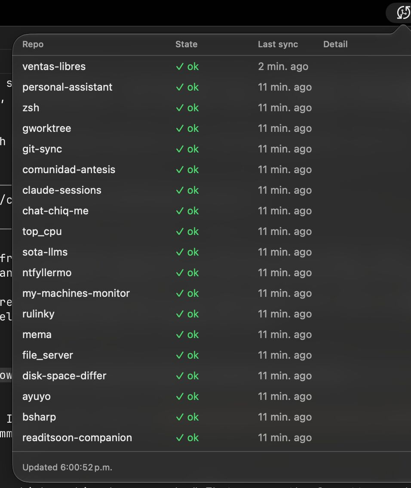

# git-sync

**Commit on one machine. It's already on the others.**



You work from more than one computer: a laptop, a desktop, an always-on server.
Your code lives in the same folder on all of them. Sooner or later you commit
on one, switch to another, and realise you can't remember where the change is.
Then comes the song and dance: `git push`, `git pull`, restart the server.

git-sync does it for you. It's a single Go binary. You tell it which repos and
which machines to sync, and after that:

1. You commit on any machine.
2. A hook pushes to the remote you already use (GitHub, say).
3. It sends an SSH message to the other machines: "there's something to pull."
4. Each one fetches from the same remote and fast-forwards. Seconds later, the
   commit is there.

Your machines feel like one, far more powerful than any of them alone.

## Why you might like it

- **No repository data travels from machine to machine.** Git's remote carries
  the code. SSH only rings the doorbell.
- **No daemon watching your files**, no custom protocol, and no copy of your
  code on someone else's server.
- **Conservative by design.** It never commits for you and never merges
  anything that isn't a fast-forward. If two machines truly diverged, it tells
  you and leaves them alone.
- **Sync that deploys.** If a repo has an executable `./activate` at its root,
  git-sync runs it on every machine that receives the change. Commit on the
  laptop and a few seconds later the server on the other machine is running
  the new version.
- **Know when something is wrong.** A small macOS menu bar app spins while
  syncing and gets a red dot when a repo has a problem: a rejected push,
  diverged history, a failed `./activate`. Click it for one row per repo, and
  click a problem to retry it.

## Install

You need key-only SSH from every machine to every other, the same repos cloned
at the same relative path on each, and push access to their shared remote.
Then, once, on any one machine:

```bash
go build -o git-sync ./cmd/git-sync
./git-sync install ~/code --peer you@other-machine.local --peer you@a-third-machine
```

`install` checks that every pair of machines can reach each other, lets you
pick the repos to sync, verifies that each machine has them, and sets up the
hooks and config on every machine over SSH. Nothing is typed on the others. If
you name no peers, it scans your local network for SSH hosts and lets you pick.

For the menu bar app (macOS, needs Xcode's Swift toolchain and
`brew install librsvg`):

```bash
git-sync-status/build
```

## Making synced code live

Add an executable `./activate` to a repo to make a sync deploy it. For a
service that only needs restarting, two lines are enough:

```sh
#!/bin/sh
exec ./serve
```

Only machines that *receive* a change run it, never the one that committed.
Failures show up in the menu bar app and in `git-sync report`.

## Documentation

The [reference](docs/REFERENCE.md) covers how a sync works step by step, every
`install` flag, every command, `./activate` in detail, troubleshooting and
known limitations.

## Platforms

macOS and Linux, on arm64 or amd64. The menu bar app is macOS only.

## Licence

git-sync is free software under the [GNU Affero General Public License v3.0](LICENSE).
Use it, fork it, change it, run it on as many of your own machines as you like.
If you publish a modified version, or offer it to others over a network, the AGPL
asks that you publish your changes under the AGPL too.

For anyone who cannot work under those terms, a separate commercial licence is
available — see [LICENSE-COMMERCIAL.md](LICENSE-COMMERCIAL.md).
